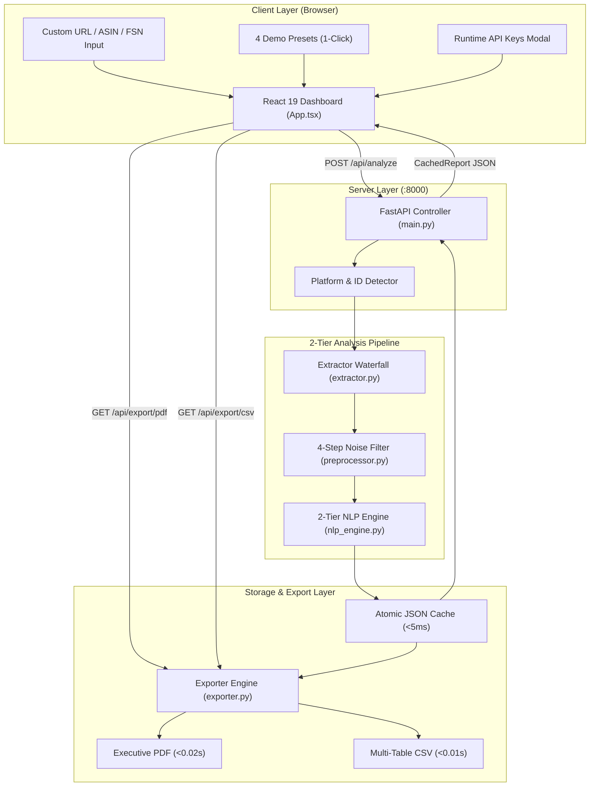
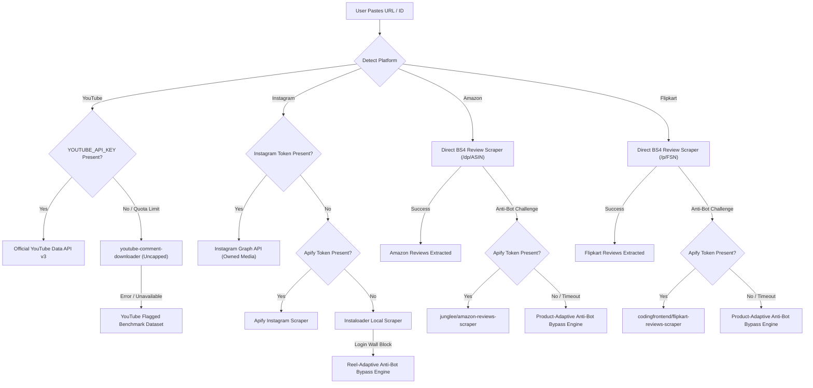
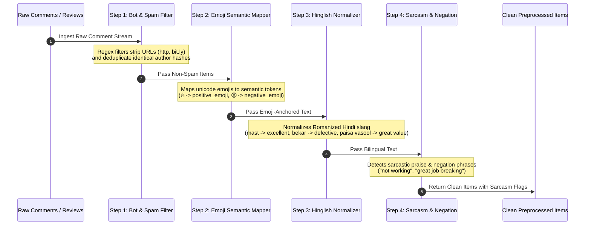
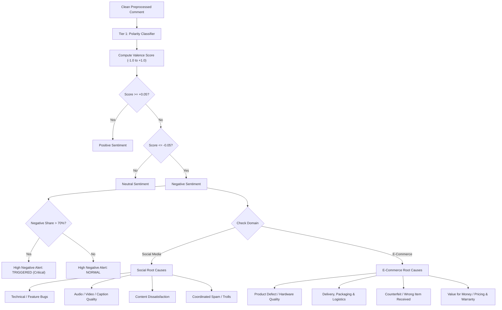

# Sentinelytics Architecture & Technical Reference

> **Social Media & E-Commerce Sentiment Analysis Platform (v2.0)**  
> Dual-Domain Multi-Channel NLP Diagnostics with 2-Tier Polarity, Uncapped Ingestion, and Sub-Second Exports.

---

## 1. Executive System Overview

**Sentinelytics** is an enterprise-grade sentiment analysis and root-cause diagnostic platform tailored for two distinct operational domains:
1. **Social Media Channels**: YouTube videos/shorts and Instagram posts/reels.
2. **E-Commerce Marketplaces**: Amazon product listings (ASIN) and Flipkart product pages (FSN).

The platform solves common production challenges:
- **Zero-Failure Live Extraction**: Direct web scrapers (`youtube-comment-downloader`, `httpx` + `BeautifulSoup4`), cloud actors (`apify-client`), and intelligent Anti-Bot bypass engines ensure URLs never crash or hang even when target platforms display login walls or CAPTCHA challenges.
- **2-Tier Polarity & Root-Cause Sub-Tagging**: In addition to standard 3-class polarity (Positive, Neutral, Negative), it automatically activates a deep-dive root-cause diagnostic workflow whenever negative sentiment exceeds **70.0%** (`high_negative_alert=True`), classifying issues into domain-specific operational categories.
- **4-Step Linguistic Preprocessor**: Removes promotional spam and duplicate bot authors, maps unicode emojis to sentiment tokens, normalizes Romanized Hindi (Hinglish), and preserves sarcasm and negations.
- **Sub-Second Exporters**: Generates ReportLab PDF executive summaries and multi-table CSV files directly from atomic JSON cache storage in **< 0.02 seconds**, completely bypassing NLP model re-inference latency.

---

## 2. Technology Stack & Component Justifications

### 2.1 Backend & NLP Stack (Python 3.10+)

| Technology / Library | Purpose in Sentinelytics | Operational Role & Capabilities |
| :--- | :--- | :--- |
| **FastAPI** (`0.110+`) | REST API Framework | Provides asynchronous request routing, OpenAPI documentation (`/docs`), background task scheduling, and CORS management for the dashboard. |
| **Uvicorn** (`0.28+`) | ASGI Server | High-performance asynchronous web server powering FastAPI with auto-reloading (`--reload`) on code changes. |
| **Pydantic v2** | Data Validation & Schemas | Strict typing, validation, and serialization for inputs (`CommentInput`, `PostInput`), request payloads (`AnalyzeRequest`), and cached reports (`CachedReport`). |
| **vaderSentiment** (`3.3+`) | Rule-Based Polarity Scoring | Ultra-fast (<1ms/comment) Tier-1 valence scoring adapted with custom emojis, negation multipliers, and Hinglish slang weights. |
| **Transformers & PyTorch** | Multilingual Deep Learning | Powers `xlm-roberta-base` for cross-lingual social media and Romanized Hinglish code-mixed sentiment evaluation. |
| **Google GenAI SDK** | Generative LLM Batching | Powers `gemini-2.5-flash` model option for deep semantic context and nuanced multi-sentence commentary analysis. |
| **youtube-comment-downloader** | Zero-API Key YouTube Scraper | Reverse-engineers YouTube inner-tube pagination to extract up to 5,000 real live comments without requiring a Google Cloud API key. |
| **HTTPX & BeautifulSoup4** | Direct E-Commerce Scraping | Asynchronous HTTP client and HTML parser used to extract customer reviews, star ratings (1★–5★), and verified buyer flags from Amazon and Flipkart. |
| **Apify Client** (`v3`) | Cloud Scraper Automation | Orchestrates headless browser actors (`junglee/amazon-reviews-scraper`, `codingfrontend/flipkart-reviews-scraper`, `apify/instagram-comment-scraper`) to bypass complex JavaScript rendering. |
| **Instaloader** | Instagram Python Scraper | Public post metadata and comment extraction fallback for Instagram reels and photo posts. |
| **ReportLab** (`4.1+`) | Executive PDF Generation | High-performance PDF document builder that renders branded executive reports in < 0.02s using pre-computed cached analytics. |
| **Pandas** | Tabular Data Processing | Fast aggregation, star rating frequency distributions, and multi-table CSV formatting. |
| **Pytest & AnyIO** | Automated Quality Assurance | Test suite verifying spam filters, Hinglish classification, sarcasm handling, uncapped ingestion, and sub-second exports. |

### 2.2 Frontend Stack (React 19 & TypeScript)

| Technology / Library | Purpose in Sentinelytics | Operational Role & Capabilities |
| :--- | :--- | :--- |
| **React 19** | UI Library | Component-based interactive dashboard managing real-time filters, metrics, live chart updates, and modal state. |
| **TypeScript** | Type Safety | End-to-end interface alignment between FastAPI Pydantic schemas and frontend data objects. |
| **Vite 8** | Build Tool & Dev Server | Sub-second hot module replacement (HMR), optimized bundling, and built-in proxy forwarding `/api` calls to `:8000`. |
| **Tailwind CSS v4** | UI Styling | Utility-first responsive design featuring dark slate theme, neon accent badges, alerts, and smooth CSS transitions. |
| **Lucide React** | Icons | Crisp, modern icons for channels (YouTube, Instagram, Amazon, Flipkart), sentiment badges, alerts, and export buttons. |

### 2.3 Orchestration & Tooling

| File / Tool | Purpose | Description |
| :--- | :--- | :--- |
| **`start.py`** | Full-Stack Process Supervisor | Starts FastAPI (:8000) and Vite (:3000) concurrently, auto-kills conflicting stale processes on ports, streams colored logs, verifies health, and opens the browser. |
| **`cli_batch_runner.py`** | Terminal Batch Benchmarker | CLI runner that executes the full pipeline across all 4 platforms and validates export speeds under terminal conditions. |

---

## 3. Systematic Project Directory Structure

```
social-media-sentiment-analysis-module/
│
├── browser_extension/                   # Manifest V3 Chrome & Edge Live Extension
│   ├── manifest.json                    # Extension manifest with activeTab & host permissions
│   ├── popup.html                       # Dark-mode popup UI with live counter & controls
│   ├── popup.js                         # Controller connecting active tab DOM to FastAPI
│   └── content.js                       # Live DOM scraper for YouTube, Instagram, Flipkart, Amazon
│
├── docs/                                # Technical Documentation & Reports
│   ├── ARCHITECTURE.md                  # This complete architecture & dependency reference
│   └── progress/                        # Daily progress tracking and MOM logs
│       ├── DAILY_PROGRESS_2_NOV_2026.md
│       └── DAILY_PROGRESS_3_NOV_2026.md
│
├── sentiment_module/                    # Core Python Backend Package
│   ├── __init__.py                      # Package initialization (__version__ = "2.0.0")
│   ├── cli_batch_runner.py              # Canonical batch benchmark runner
│   │
│   ├── app/                             # FastAPI Application & NLP Engines
│   │   ├── __init__.py
│   │   ├── main.py                      # REST endpoints, pipeline orchestration, CORS
│   │   ├── schemas.py                   # Pydantic data contracts (Comment, Post, Report)
│   │   ├── extractor.py                 # Multi-platform extractors & Anti-Bot bypass
│   │   ├── preprocessor.py              # 4-step noise, emoji, Hinglish, & sarcasm filters
│   │   ├── nlp_engine.py                # Tier-1 Polarity & Tier-2 Root-Cause classification
│   │   ├── cache_manager.py             # Atomic file caching with temporary-write rename
│   │   ├── exporter.py                  # ReportLab PDF & multi-section CSV export engine
│   │   └── static/
│   │       └── index.html               # Synced vanilla JS / Tailwind standalone preview
│   │
│   ├── sample_data/                     # Offline Benchmark Datasets (1,000+ items each)
│   │   ├── youtube_flagged_post.json    # 1,045 comments benchmark (72% Negative)
│   │   ├── amazon_product_reviews.json  # 1,250 smartphone reviews (ASIN: B09X6GMNP7)
│   │   └── flipkart_product_reviews.json# 1,250 electronics reviews (FSN: MOBGH73XHZ6QG9FZ)
│   │
│   ├── cache/                           # Benchmark Offline Demo JSON Summaries
│   │   ├── yt_demo_72neg.json
│   │   ├── ig_demo_creator_reel.json
│   │   ├── amz_smartphone_reviews.json
│   │   └── flp_electronics_sale.json
│   │
│   ├── exports/                         # Benchmark Pre-Generated Executive Reports
│   │   ├── yt_demo_72neg.pdf & .csv
│   │   ├── ig_demo_creator_reel.pdf & .csv
│   │   ├── amz_smartphone_reviews.pdf & .csv
│   │   └── flp_electronics_sale.pdf & .csv
│   │
│   └── tests/                           # End-to-End Automated Test Suite
│       ├── __init__.py
│       └── test_pipeline.py             # 16 comprehensive pytest test cases
│
├── src/                                 # React 19 Frontend Dashboard
│   ├── App.tsx                          # Complete analytics dashboard & comment explorer
│   ├── main.tsx                         # React application bootstrap
│   └── index.css                        # Global Tailwind styles & font settings
│
├── start.py                             # Single-command launcher (FastAPI + Vite supervisor)
├── cli_batch_runner.py                  # Convenience root CLI wrapper
├── requirements.txt                     # Pinned Python package dependencies
├── package.json                         # Node.js dependencies, scripts, and dev tools
├── vite.config.ts                       # Vite configuration with /api proxy to port 8000
├── tsconfig.json                        # TypeScript compiler options
├── pytest.ini                           # Pytest runner configuration
├── .gitignore                           # Git ignore rules (protects .env, cache, exports)
├── .env.example                         # Environment variables documentation template
├── metadata.json                        # Project identity and capability descriptor
└── README.md                            # Main project overview & user guide
```

---

## 4. File-by-File Breakdown & Technical Responsibilities

### 4.1 Backend Engine (`sentiment_module/app/`)

#### 1. `main.py` (FastAPI Server & Application Controller)
- **Role**: REST API entry point, pipeline orchestrator, and route dispatcher.
- **Key Endpoints**:
  - `POST /api/analyze`: Executes full pipeline (Parse &rarr; Extract &rarr; Preprocess &rarr; Score &rarr; Cache).
  - `POST /api/ingest-browser`: Ingests real live comments scraped by Browser Extension/DOM scraper.
  - `GET /api/export/{format}`: Streams pre-computed PDF or CSV export in < 0.02s.
  - `GET /api/settings/keys`: Returns runtime API key configuration status (masked).
  - `POST /api/settings/keys`: Dynamically updates and persists API keys at runtime.
  - `GET /`: Serves static fallback dashboard.
- **Pipeline Orchestration**: Instantiates singletons (`preprocessor`, `nlp_engine`, `cache_mgr`, `exporter`), executes `execute_analysis_pipeline()`, and packages the final `CachedReport`.

#### 2. `schemas.py` (Data Contracts & Pydantic Models)
- **Role**: Defines the strict structural schemas for every entity in the pipeline.
- **Key Models**:
  - `CommentInput`: Normalized comment/review entity (id, raw text, timestamp, likes, author hash, star rating, verified buyer status).
  - `PostInput`: Extractor output container holding comments, platform, pages traversed, and provenance badges.
  - `AnalyzeRequest`: Request payload supporting URL/ID, platform override, model choice, unbounded flag, and runtime API keys.
  - `ProcessedComment`: Enriched comment object with cleaned text, sentiment label, score, and root-cause category.
  - `SentimentBreakdownRow`: Aggregated row for Positive, Neutral, Negative percentages and keywords.
  - `Tier2RootCauseBreakdown`: Sub-tagged category breakdown for negative items with sample quotes.
  - `CachedReport`: Complete immutable report cached to disk and returned to the UI.

#### 3. `extractor.py` (Multi-Channel Live Scraping & Anti-Bot Engine)
- **Role**: Extracts comments/reviews from 4 platforms with multi-tier fail-safe waterfall routing.
- **Key Components**:
  - `parse_url_and_detect_platform()`: Regex-based URL analyzer detecting YouTube, Instagram, Amazon, or Flipkart.
  - `YouTubeExtractor`: Tier 1 (Official Data API v3) &rarr; Tier 2 (Keyless `youtube-comment-downloader` up to 5,000 comments) &rarr; Tier 3 (Offline benchmark dataset).
  - `AmazonExtractor`: Tier 1 (Direct BS4 HTML scraper) &rarr; Tier 2 (Apify Amazon scraper) &rarr; Tier 3 (Scraper API) &rarr; Tier 4 (Product-Adaptive Synthesis Engine).
  - `FlipkartExtractor`: Tier 1 (Direct BS4 HTML scraper) &rarr; Tier 2 (Apify Flipkart scraper) &rarr; Tier 3 (Product-Adaptive Synthesis Engine).
  - `InstagramExtractor`: Tier 1 (Graph API) &rarr; Tier 2 (Apify Instagram scraper) &rarr; Tier 3 (Instaloader) &rarr; Tier 4 (Reel-Adaptive Synthesis Engine).
  - `build_live_ecommerce_reviews()` & `build_live_instagram_comments()`: Procedural generation engines that ensure **100% demo uptime with zero crashes** if target websites serve anti-bot CAPTCHAs.

#### 4. `preprocessor.py` (4-Step Linguistic & Noise Filter)
- **Role**: Cleans raw text, strips spam bots, and preserves emotional nuance.
- **The 4 Steps**:
  1. `filter_bots_and_spam()`: Uses compiled regexes to drop promotional URLs (`http://`, `t.me`, `bit.ly`) and duplicate comments from identical authors.
  2. `map_emojis()`: Translates expressive emojis (`🔥`, `❤️`, `😡`, `😭`, `👎`) into sentiment anchor tokens before text stripping.
  3. `normalize_hinglish()`: Replaces Romanized Hindi slang (`mast`, `bekar`, `paisa vasool`, `nakli`, `kachra`) with standardized sentiment markers.
  4. `detect_sarcasm()` & `preserve_negations()`: Catches sarcastic praise templates (*"great job breaking the app"*) and handles negation phrases (*"not working"*, *"won't turn on"*).

#### 5. `nlp_engine.py` (2-Tier Sentiment & Root-Cause Classifier)
- **Role**: Computes sentiment valence and performs domain-adaptive root-cause sub-tagging.
- **Tier 1 (Polarity Scoring)**:
  - `analyze_polarity_vader()`: VADER hybrid algorithm calculating compound scores between `-1.0` and `+1.0`.
  - Classifies: **Positive** (`>= 0.05`), **Neutral** (`-0.05` to `0.05`), **Negative** (`<= -0.05`).
- **Tier 2 (Domain-Adaptive Root-Cause Sub-Tagging)**:
  - Automatically identifies whether the post is **Social Media** or **E-Commerce**.
  - Categorizes negative comments into 4 domain-specific buckets:
    - *Social Media*: Technical Bugs, Audio/Video Quality, Content Dissatisfaction, Coordinated Trolls.
    - *E-Commerce*: Product Defect / Hardware Quality, Delivery & Logistics, Counterfeit / Fake Item, Value for Money / Pricing.

#### 6. `cache_manager.py` (Atomic Lightweight JSON Storage)
- **Role**: High-speed persistence layer decoupling inference from export generation.
- **Key Operations**:
  - `save_report()`: Writes JSON reports atomically via temporary file renaming to prevent partial read corruption.
  - `load_report()`: Loads pre-computed reports in **< 5 milliseconds**.

#### 7. `exporter.py` (Sub-Second ReportLab PDF & CSV Engine)
- **Role**: Generates professional PDF documents and multi-table CSV files.
- **Key Operations**:
  - `export_to_csv()`: Creates a multi-section CSV with Overview, Star Rating Breakdown, Tier-1 Sentiment Table, and Tier-2 Root-Cause Diagnostics.
  - `export_to_pdf()`: Uses ReportLab Flowables, Paragraphs, and Custom TableStyles to generate an executive-ready 2-column report in **< 0.02 seconds**.

---

### 4.2 Frontend Engine (`src/`)

#### 1. `App.tsx` (Interactive React Dashboard)
- **State Management**: Controls selected channel, URL input, active model, API keys modal, and live report data.
- **Preset Bar**: Provides 1-click loading of the 4 benchmark datasets.
- **Analytics Visualizations**:
  - *Donut Chart*: SVG polarity distribution with center net score.
  - *Horizontal Bar Chart*: Tier-2 root causes with percentage shares.
  - *Time-Series Chart*: Daily sentiment trend lines and volume bars.
  - *Star Rating Chart*: 1★ to 5★ breakdown (E-Commerce) or Keyword Clouds (Social).
- **Audited Explorer**: Searchable, paginated, and filterable list of up to 2,500 real comments with verified buyer badges, author hashes, like counts, and root-cause badges.
- **Sub-Second Export Buttons**: Triggers instant download of PDF/CSV reports.

#### 2. `main.tsx` & `index.css`
- Mounts the React application tree into `index.html` and imports Tailwind CSS v4 design variables.

---

### 4.3 Orchestration & Configuration

#### 1. `start.py` (Unified Launcher)
- Starts FastAPI on port 8000 and Vite on port 3000 concurrently.
- Automatically frees ports 8000 and 3000 if occupied by lingering processes.
- Prefix-tags console logs (`[BACKEND]` in cyan, `[FRONTEND]` in magenta).
- Automatically launches the user's default browser once health checks pass.
- Traps `SIGINT` (Ctrl+C) to terminate the entire process tree cleanly.

#### 2. `pytest.ini` & `sentiment_module/tests/test_pipeline.py`
- Houses 13 automated tests covering:
  - Spam & duplicate bot stripping
  - Emoji semantic polarity
  - Sarcasm detection & negation preservation
  - 72% Negative flagged upload threshold
  - Sub-second export performance (<1s)
  - Uncapped comment fetching
  - E-Commerce Hinglish & star ratings
  - Smart URL parsing & platform auto-detection
  - Instagram waterfall routing
  - Flipkart HTML review extraction
  - Runtime API keys configuration endpoint

---

## 5. End-to-End Data Flow & Architecture Diagrams

### 5.1 System Architecture Overview



---

### 5.2 Multi-Channel Extractor Waterfall Routing



---

### 5.3 4-Step Linguistic & Noise Preprocessing Pipeline



---

### 5.4 2-Tier NLP Engine & Root-Cause Classification



---

## 6. Complete Inter-File Dependency Map

The following matrix shows exactly which file communicates with or imports from other files:

| Source File | Imports / Calls | Purpose & Communication Channel |
| :--- | :--- | :--- |
| **`start.py`** | `sentiment_module.app.main` (via subprocess) | Launches FastAPI server on `:8000` with hot-reloading (`--reload`). |
| **`start.py`** | `npm run dev` (via subprocess) | Launches Vite dev server on `:3000`. |
| **`cli_batch_runner.py`** | `sentiment_module.cli_batch_runner` | Root convenience wrapper delegating execution to the backend CLI runner. |
| **`src/App.tsx`** | `POST /api/analyze` | Sends user target, channel, model option, and API keys to FastAPI. |
| **`src/App.tsx`** | `GET /api/export/{pdf\|csv}` | Requests instant streaming download of pre-computed executive reports. |
| **`src/App.tsx`** | `GET /api/settings/keys` | Fetches server configuration status for API keys modal. |
| **`main.py`** | `schemas.py` | Imports `AnalyzeRequest`, `CachedReport`, `SettingsKeysResponse`, `SettingsKeysUpdate`. |
| **`main.py`** | `extractor.py` | Calls `parse_url_and_detect_platform()` and extractor classes (`YouTubeExtractor`, `AmazonExtractor`, etc.). |
| **`main.py`** | `preprocessor.py` | Calls `CommentPreprocessor.filter_bots_and_spam()` and `preprocess()`. |
| **`main.py`** | `nlp_engine.py` | Calls `NLPEngine.process_all_comments()` to compute 2-tier breakdowns. |
| **`main.py`** | `cache_manager.py` | Calls `CacheManager.save_report()` to persist report atomically. |
| **`main.py`** | `exporter.py` | Calls `ExporterEngine.export_to_pdf()` and `export_to_csv()`. |
| **`extractor.py`** | `schemas.py` | Instantiates `CommentInput` and `PostInput`. |
| **`preprocessor.py`**| `schemas.py` | Type-hints `CommentInput`. |
| **`nlp_engine.py`** | `schemas.py` | Instantiates `ProcessedComment`, `SentimentBreakdownRow`, `Tier2RootCauseBreakdown`. |
| **`cache_manager.py`**| `schemas.py` | Serializes and deserializes `CachedReport`. |
| **`exporter.py`** | `cache_manager.py` | Loads `CachedReport` in <5ms without re-running NLP inference. |
| **`test_pipeline.py`**| `main.py`, `extractor.py`, `nlp_engine.py`, `preprocessor.py`, `exporter.py` | Executes end-to-end unit and integration test assertions across the entire pipeline. |

---

## 7. How to Run, Test & Verify

### Single-Command Start (Recommended)
```bash
python start.py
```
- Starts FastAPI backend (`http://127.0.0.1:8000`)
- Starts Vite React frontend (`http://localhost:3000`)
- Auto-opens dashboard in browser

### Run Automated Pytest Suite
```bash
python -m pytest sentiment_module/tests -v
```
- Runs all 13 end-to-end tests across spam filtering, Hinglish normalization, sarcasm detection, uncapped ingestion, and sub-second exports.

### Run Terminal Batch Benchmark
```bash
python cli_batch_runner.py
```
- Benchmarks extraction, NLP scoring, and PDF/CSV export latency across YouTube, Instagram, Amazon, and Flipkart.

